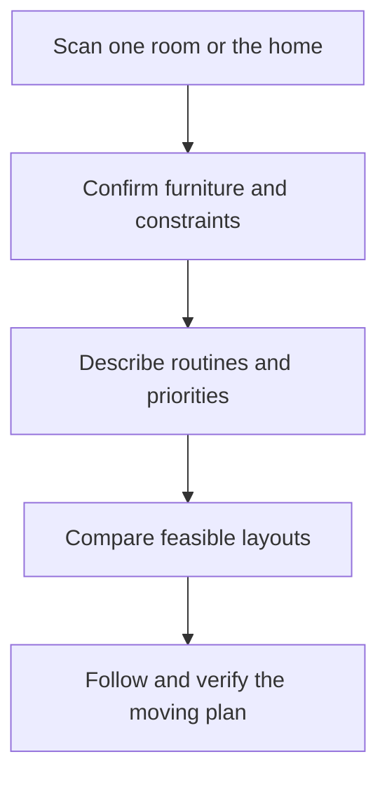

# Room Scanning

A 3D room-planning application that optimizes a real home around the furniture and belongings the resident already owns.

## Product status

This repository currently contains the product specification for the first implementation. The product name is provisional.

## 1. Product vision

Room Scanning should help people create a more efficient, comfortable, accessible, and practical home without requiring them to start with an empty virtual room or buy an entirely new interior.

Most interior-planning software begins with an empty floor plan and a catalog of products. Room Scanning begins with reality:

- the occupied home;
- its fixed structures and limitations;
- the resident's existing furniture and household belongings;
- the people, animals, routines, and activities that use the space;
- the user's priorities and restrictions.

The user scans one room or the entire home. The application reconstructs the space and current contents, learns which objects may move and how they are used, and generates feasible alternative layouts. It then explains the trade-offs and provides a safe, step-by-step sequence for moving from the current layout to the chosen one.

The primary solution must use existing possessions. Removing, storing, or purchasing items is a separate optional layer and never the default starting point.

## 2. Independent product architecture

Room Scanning is a standalone product.

It must have its own:

- scanning pipeline;
- room and furniture data model;
- object library;
- optimization engine;
- application and APIs;
- persistence layer;
- deployment;
- test suite;
- release lifecycle.

It must not require Packing Scanning or a shared Spatial Core at runtime, build time, or data-storage level.

The two products may independently use similar concepts, algorithms, platform frameworks, data-provenance labels, or design patterns. Similarity is not a reason to create a mandatory shared package. Room Scanning must be independently understandable, deployable, and replaceable.

## 3. Product principles

### Existing possessions first

Every optimization starts with the user's current furniture and belongings.

The first candidate set must solve the room with existing required items. Optional “simplify” and “minimal addition” scenarios are shown separately.

### Human usability over empty-space mathematics

A layout is not good merely because it creates the most free floor area.

The planner must consider:

- daily activities;
- movement and retrieval;
- doors, drawers, and windows;
- comfort;
- accessibility;
- cleaning;
- privacy;
- sensory preferences;
- children and pets;
- installation requirements;
- the effort and feasibility of moving objects.

### One room or the whole home

The user may optimize:

- a single room;
- selected connected rooms;
- one floor;
- the entire home.

Each object can be locked to its exact position, its current room, a set of allowed rooms, or the overall home.

### Multiple optimization modes

“Optimal” depends on the resident. The application must support distinct modes and custom combinations rather than impose one universal definition of a well-designed home.

### Scan first, verify selectively

The camera and available depth sensors should capture as much as possible. The application asks for additional information only when it materially affects the solution.

### Provenance and uncertainty

Every important property must be labeled as:

- **Measured:** derived from calibrated geometry or another sensor;
- **Known:** imported from a trusted product record;
- **Estimated:** inferred from images, object class, or similar items;
- **User-confirmed:** entered or accepted by the user.

The optimizer must include uncertainty margins and must never present an estimate as an exact measurement.

### Explainable recommendations

Every proposed move should answer:

- why it improves the layout;
- which goals it serves;
- what it makes worse;
- what assumptions it depends on;
- how confident the system is.

### No forced commerce

The product must not become a disguised furniture marketplace. Purchases are never required to view the best existing-furniture layout.

## 4. Target users

Initial users include:

- residents who want to improve a room using what they already own;
- people moving into a different home with existing furniture;
- households with limited floor or storage space;
- renters who cannot make structural changes;
- people with mobility or accessibility needs;
- autistic or sensory-sensitive residents;
- families with children;
- households with pets;
- people who struggle with spatial planning or decision overload;
- carers, occupational professionals, and organizers acting with the resident's permission.

Professional interior designers may use the product later, but the first experience is designed for ordinary residents.

## 5. Core user journey

### 5.1 Create a home

The user creates a home without being required to disclose a precise street address.

The home can contain:

- floors;
- rooms;
- hallways;
- stairs;
- connected spaces;
- balconies or indoor-outdoor transition zones;
- household members;
- pets;
- accessibility requirements;
- tenancy restrictions;
- general design preferences.

A home may be scanned incrementally. One completed room must remain useful without requiring the entire building.

### 5.2 Scan the room structure

The application guides the user around the occupied room and captures:

- floor boundary;
- wall geometry;
- ceiling height and slopes;
- pillars, beams, alcoves, and structural intrusions;
- windows and sill height;
- doors, openings, and door-swing volume;
- stairs and level changes;
- fireplaces;
- radiators and other heat sources;
- ventilation openings;
- fixed lighting;
- built-in furniture;
- plumbing fixtures;
- permanent installations.

Small but important elements, such as sockets, switches, network points, thermostats, and cable entry points, may require a focused secondary capture because standard room frameworks do not identify all such objects.

Each structural element receives:

- geometry;
- type;
- confidence;
- fixed/movable state;
- required clearance;
- source scan;
- user correction history.

### 5.3 Scan the occupied room and furniture

The application should identify large objects during the room scan and preserve their current transforms.

For every object, record where possible:

- identity or category;
- current room and position;
- 3D collision geometry;
- visual model;
- dimensions;
- front, back, top, and access sides;
- current contents;
- mobility class;
- estimated or measured mass class;
- stability and tipping considerations;
- connection requirements;
- clearance required to use it;
- uncertainty and scan coverage.

Support two refinement paths:

#### In-place refinement

The user walks around the furniture while it remains in the room. This is suitable when enough surfaces are visible.

#### Individual object scan

Used when the object is heavily occluded, irregular, important to clearances, or likely to move between rooms. The object may be scanned after temporary access is created.

The application must not require every decorative or small object to have a detailed mesh. Small belongings can be grouped into movable containers or zones unless their individual placement matters.

### 5.4 Build the household object library

Confirmed furniture and reusable household objects become part of a private library.

Store:

- canonical identity;
- photographs and visual model;
- simplified collision geometry;
- dimensions and uncertainty;
- current and historical locations;
- ownership;
- use frequency;
- mobility;
- weight class;
- fragility;
- opening and use clearances;
- connection requirements;
- compatibility relationships;
- room restrictions;
- whether wall/floor attachment is required;
- child/pet considerations;
- confirmation and rescan history.

An unchanged confirmed object can be reused in future layouts or a newly scanned home without a full rescan.

### 5.5 Correct the digital twin

The user reviews a simple 2D and 3D representation.

They can:

- correct walls and openings;
- merge duplicate furniture;
- split incorrectly merged objects;
- classify an unknown object;
- adjust dimensions;
- mark hidden fixtures;
- add missing sockets or radiators;
- indicate that an object is fixed;
- define a door or drawer opening direction;
- hide irrelevant visual clutter;
- request a targeted rescan.

Only uncertainties that can materially alter feasibility should interrupt the user.

## 6. Household and activity profile

Geometry alone cannot define a good home.

The application can collect:

- residents and regular visitors;
- pets;
- rooms used by each person;
- mobility aids;
- reach limitations;
- sensory preferences;
- privacy needs;
- supervision needs;
- dominant hand where relevant;
- daily and weekly activities;
- common sequences such as entering, removing shoes, storing keys, and sitting down;
- frequently used object pairs;
- cleaning methods and equipment;
- work, study, sleep, dining, exercise, play, care, and hobby zones;
- quiet and social periods;
- desired views and sight lines;
- objects that must stay accessible;
- objects that should remain hidden.

Sensitive personal or medical details are optional. The system must not infer diagnoses or disabilities from scans or movement without explicit user participation.

Users can define activity scenarios such as:

- normal weekday;
- working from home;
- hosting visitors;
- sleeping arrangement;
- child playtime;
- wheelchair or rollator route;
- cleaning;
- emergency exit.

## 7. Object and room constraints

### Object properties

An object may define:

- fixed, difficult, assisted, or easy movement;
- allowed rooms;
- locked position;
- required wall contact;
- prohibited wall contact;
- permitted orientation;
- minimum access clearance;
- door, lid, drawer, or reclining envelope;
- seating and approach space;
- ventilation clearance;
- heat or moisture sensitivity;
- power, data, water, or drainage connection;
- cable-route limit;
- wall or floor anchoring;
- load-bearing limit;
- fragility;
- nesting or stacking;
- compatibility and separation;
- visibility preference;
- natural-light preference;
- acoustic preference.

### Room properties

A room may define:

- permitted functions;
- fixed function;
- noise sensitivity;
- privacy;
- daylight;
- usable power and network locations;
- moisture and ventilation;
- heat sources;
- cleaning access;
- child/pet zones;
- inaccessible or protected areas;
- rental restrictions;
- no-drill surfaces.

### Hard versus soft constraints

Hard constraints cannot be violated. Examples:

- an object cannot intersect a wall;
- a required exit must remain usable;
- a wheelchair route must meet the user-confirmed clearance;
- a cabinet door must open;
- a washing machine must remain at a suitable connection;
- a fixed object cannot move.

Soft constraints are scored. Examples:

- prefer the desk near daylight;
- reduce visible clutter;
- place frequently used objects closer;
- avoid moving the heaviest cabinet;
- improve conversational sight lines.

The interface must clearly distinguish a safety/feasibility constraint from a preference.

## 8. Optimization modes

### Balanced

Balances usable space, activity support, accessibility, cleaning, comfort, safety, and moving effort. This is the default.

### Maximum Open Space

Maximizes useful continuous floor area and reduces fragmented dead space while preserving required use clearances.

### Daily Comfort

Optimizes activity zones, common routes, frequently used objects, and ergonomic access.

### Accessibility

Prioritizes user-defined route width, turning areas, reach, approach direction, transfer space, and obstacle reduction.

The application must not claim formal regulatory compliance unless an applicable standard and all required measurements have been explicitly validated.

### Easy Cleaning

Reduces inaccessible gaps, improves floor access, avoids unnecessary object movement during cleaning, and preserves space for the user's cleaning equipment.

### Storage

Improves storage accessibility and adjacency between stored items and their use zones. It can suggest consolidating contents before recommending new storage.

### Calm / Low Stimulus

Reduces visual clutter, conflicting sight lines, crowded routes, and overstimulating zones according to user preferences.

### Social

Optimizes seating, conversation sight lines, shared surfaces, circulation, and flexible visitor capacity.

### Child or Pet Aware

Includes user-confirmed hazards, fragile-item protection, supervision sight lines, play/rest zones, climbability, and escape/entrapment risks.

### Custom

Allows the user to combine hard rules and weighted objectives. The interface should provide understandable presets rather than expose raw mathematical weights by default.

## 9. Scope of optimization

### Single room

Furniture remains in the selected room unless explicitly permitted to leave.

### Selected rooms

The solver may exchange objects and functions between chosen rooms.

### Whole home

The solver treats rooms, hallways, and floors as one connected structure while preserving:

- object-room eligibility;
- privacy;
- installation dependencies;
- path feasibility;
- floor transitions;
- carrying constraints;
- household assignments.

### Function reassignment

The user may allow the planner to change room functions, such as:

- combining office and guest use;
- moving dining to a better-connected zone;
- turning an underused room into storage or work space;
- redistributing children's activities.

Function changes are never made without explicit permission.

## 10. Three solution layers

### 10.1 Existing Furniture Only

The primary result:

- uses current required furniture;
- makes no purchase assumptions;
- keeps all objects unless the user marked them optional;
- may move objects between permitted rooms;
- explains any infeasibility.

### 10.2 Simplify

An optional comparison that may:

- place low-priority objects in existing storage;
- move objects to another permitted room;
- recommend temporary removal from the active layout;
- identify duplicates or objects that block disproportionate space.

It must not tell users to discard possessions as if that decision were objective. It shows spatial consequences and lets the user decide.

### 10.3 Minimal Addition

An optional final comparison that can propose a small missing aid only when:

- the existing-only solution has already been shown;
- the addition solves a defined problem;
- the user enabled purchase suggestions;
- budget, dimensions, installation, rental restrictions, and safety are respected;
- the benefit is quantified or clearly explained.

Examples may include a shelf, cable channel, riser, divider, wall hook, or alternative storage insert. Paid or sponsored results must be disclosed and must not influence the existing-only score.

## 11. Layout optimization engine

The central problem is constrained spatial layout optimization with navigation, activities, uncertainty, and human effort.

### Inputs

- room or multi-room geometry;
- structural obstacles;
- movable and fixed objects;
- object use envelopes;
- connection points;
- household/activity profile;
- route and accessibility requirements;
- hard and soft constraints;
- selected optimization mode;
- current layout;
- scan uncertainty.

### Feasibility stages

1. normalize geometry and coordinate systems;
2. classify fixed, movable, and conditionally movable objects;
3. generate allowed placement surfaces and zones;
4. eliminate impossible room-object assignments;
5. generate candidate poses and room allocations;
6. check collisions and use envelopes;
7. validate doors, windows, routes, and connections;
8. score activity, comfort, accessibility, cleaning, sensory, and moving objectives;
9. apply uncertainty margins;
10. select meaningfully different Pareto candidates;
11. produce explanations and a feasible moving sequence.

### Solver requirements

- deterministic mode for test reproduction;
- hard constraints enforced separately from scores;
- no generative model as the geometric feasibility authority;
- several diverse feasible candidates;
- explicit infeasibility explanations;
- incremental recalculation after user changes;
- exact geometry where required and conservative approximations where safe;
- support for locked objects and locked zones;
- support for user-approved room-function changes.

A layout with a higher score must not be shown as universally “better.” The score is relative to the selected household priorities.

## 12. Safety and practical checks

The application should check, when data is available:

- door and window operation;
- primary and emergency routes;
- trip and collision hazards;
- furniture stability and tipping risk;
- wall/floor anchoring requirements;
- heat-source and ventilation clearance;
- access to sockets, switches, controls, and shutoffs;
- cable paths;
- wet-area suitability;
- stair and level-change obstruction;
- child and pet hazards;
- lifting and carrying difficulty;
- whether an object can physically pass through doors and hallways;
- temporary staging space needed during rearrangement.

These are decision-support warnings, not certification. Building, fire, electrical, accessibility, rental, and product-safety rules vary by jurisdiction and property. The app must show the source and applicability of any formal rule it uses.

## 13. Candidate layouts and comparison

For each candidate, show:

- interactive 2D floor plan;
- interactive 3D view;
- current-versus-proposed comparison;
- objects that move;
- room-function changes;
- free and usable floor area;
- route and bottleneck analysis;
- accessibility score;
- cleaning score;
- storage score;
- activity-zone score;
- sensory/calm score where enabled;
- moving difficulty;
- number of assumptions;
- uncertainty and clearance margin;
- major benefits;
- major trade-offs;
- unresolved warnings.

Do not overwhelm the user with dozens of near-identical arrangements. Return a small set of meaningfully different options.

The user can:

- rotate and inspect;
- lock an object;
- reject a room assignment;
- modify priorities;
- request a variant;
- combine selected aspects where feasible;
- save multiple scenarios.

## 14. AR preview

AR preview is optional and is used after a candidate exists.

It can show:

- a moved object's proposed position;
- footprint and clearance zones;
- door/drawer swing;
- walking route;
- before/after overlay;
- uncertainty boundary;
- sequence step.

The interface must not encourage a user to walk backward into real furniture. It should provide stationary inspection points and clear physical-safety guidance.

A 2D/3D non-AR plan remains fully usable on devices without suitable AR capability.

## 15. Rearrangement sequence

The product must generate an executable transition from the current layout to the chosen layout.

Each step includes:

- object and destination;
- preparation, such as emptying or disconnecting;
- required number of people or equipment;
- temporary staging location;
- carrying path;
- orientation through openings;
- hazards;
- items that must move first;
- reconnection or anchoring;
- confirmation controls.

The sequence solver must avoid circular blocking. It should detect when temporary free space is insufficient and offer options such as:

- use another room as staging;
- split the work into zones;
- temporarily move an optional item;
- request assistance;
- select a lower-effort layout.

The app must never suggest that a user move an unsafe weight alone.

## 16. Verify and replan

After or during rearrangement, the user can:

- mark a step complete;
- report that an object does not fit;
- report an unavailable path;
- correct a dimension;
- lock completed placements;
- skip or postpone an object;
- rescan a room or object;
- compare actual and planned placement;
- recalculate remaining steps;
- restore the saved original layout.

Replanning must preserve confirmed placements unless the user permits changes.

## 17. Standalone technical architecture

### Mobile application

Responsible for:

- onboarding and home setup;
- native camera/depth capture;
- immediate scan-quality guidance;
- 2D/3D and AR visualization;
- local object-library access;
- scenario comparison;
- rearrangement instructions;
- offline access;
- privacy and deletion controls.

### Room reconstruction service

Responsible for:

- room structure;
- multi-room registration;
- wall, opening, and fixed-feature normalization;
- mesh repair;
- metric scale;
- uncertainty;
- visual and collision models.

Support on-device processing where device capability permits it.

### Furniture intelligence service

Responsible for:

- object detection and segmentation;
- object refinement;
- product matching where permitted;
- use-envelope templates;
- property inference;
- confidence and provenance;
- object-library deduplication.

### Household modeling service

Responsible for:

- residents and pets;
- activities and zones;
- preferences;
- accessibility constraints;
- room functions;
- scenario profiles.

### Layout solver

Responsible for:

- room allocation;
- object pose generation;
- geometric feasibility;
- routes and clearances;
- multi-objective scoring;
- diverse candidates;
- incremental replanning;
- explanations.

### Sequence solver

Responsible for:

- staging;
- carrying paths;
- dependency order;
- temporary layouts;
- safety warnings;
- confirmed-step replanning.

### Standalone persistence

Use an independent database, object store, identity boundary, audit system, and deployment. Do not read from or write to Packing Scanning storage.

## 18. Platform scanning approach

### iOS

Use Apple RoomPlan and ARKit on supported LiDAR devices for the first high-quality capture route. Use additional AR frames, object scanning, and recognition for details that RoomPlan does not capture.

### Android

Use ARCore Depth/Raw Depth and platform-appropriate reconstruction. Android support must have its own scan-quality certification.

### Fallback

Use guided camera capture and photogrammetry on supported non-depth devices. Capability levels must be disclosed; the application must not imply identical accuracy across all phones.

### Common internal contract

Within this repository only, define a platform-independent room scan result containing:

- metric coordinate system;
- room surfaces;
- openings;
- fixed features;
- detected objects;
- transforms;
- geometry;
- confidence;
- provenance;
- source capability;
- scan-quality metrics.

This internal contract is part of Room Scanning and is not a shared package with another product.

## 19. 3D representations

Store separate representations:

- **Source capture:** camera frames, depth, calibration, and raw reconstruction;
- **Visual model:** recognizable geometry for the user;
- **Planning model:** simplified collision and clearance geometry;
- **Semantic model:** rooms, objects, functions, connections, and relationships;
- **Current state:** confirmed actual transforms;
- **Scenario state:** proposed transforms and room functions.

Scan-quality dimensions include:

- scale accuracy;
- wall/floor completeness;
- room registration;
- object coverage;
- opening accuracy;
- semantic confidence;
- boundary uncertainty;
- visual alignment.

## 20. Conceptual data model

Core entities:

- User
- Household
- Resident
- Pet
- Home
- Floor
- Room
- RoomConnection
- StructuralElement
- Fixture
- UtilityPoint
- RoomScan
- ScanSession
- ScanQuality
- FurnitureType
- FurnitureInstance
- FurnitureScan
- ObjectProperty
- PropertyEvidence
- UseEnvelope
- MobilityProfile
- Activity
- ActivityZone
- RouteRequirement
- AccessibilityRequirement
- SensoryPreference
- RoomFunction
- Constraint
- OptimizationProfile
- LayoutScenario
- ObjectPose
- Route
- LayoutScore
- Recommendation
- OptionalRemoval
- OptionalAddition
- RearrangementPlan
- RearrangementStep
- StagingZone
- ReplanEvent
- SafetyWarning
- AuditEvent

Every inferred or measured value stores source, time, confidence, unit, and confirmation state.

## 21. Privacy and security

A home scan can reveal:

- the internal structure of a residence;
- valuable possessions;
- entrances and security features;
- medical or accessibility information;
- household composition;
- children's rooms;
- routines and absence patterns;
- a precise location.

Treat all scan and household data as sensitive.

Minimum requirements:

- no precise address required for spatial optimization;
- local processing where practical;
- explicit consent before cloud upload;
- encryption in transit and at rest;
- short-lived upload credentials;
- private-by-default homes and object libraries;
- no advertising use of scan content;
- no model training on personal scans without separate explicit opt-in;
- separate deletion of raw images, reconstructions, objects, household profiles, and scenarios;
- configurable automatic source-capture deletion;
- secure offline cache;
- least-privilege staff access;
- sensitive-access audit logs;
- export and account deletion;
- no public share links by default;
- expiration and revocation for private shares;
- analytics that exclude room images, addresses, and object inventories;
- incident response and integration kill switches.

## 22. Offline behavior

After required processing, the following must be available offline:

- current home model;
- saved rooms and furniture;
- object library;
- candidate layouts;
- current-versus-proposed comparison;
- rearrangement sequence;
- safety notes already retrieved;
- progress and confirmed placements.

Edits and step completion should synchronize later without losing the local state.

## 23. Failure handling

### Incomplete or inaccurate scan

Identify the missing area and guide a targeted rescan. Preserve confirmed room and object data.

### Occupied-room occlusion

Allow partial geometry, product records, individual refinement, or conservative bounding shapes. Do not require the entire room to be emptied before scanning.

### Unsupported device

Offer the best available fallback and explain the expected capability level.

### Multi-room alignment failure

Keep individual room scans and request a guided connection scan. Do not silently merge rooms with uncertain transforms.

### No feasible layout

Explain the blocking constraints and show:

- which required objects conflict;
- whether a single-room solution fails but a multi-room solution exists;
- which optional lock causes the conflict;
- how a simplify scenario differs.

### External service unavailable

Use cached data with its age or allow manual input. Core room planning must not depend on a product catalog or shopping service.

### Optimization timeout

Return the best already validated candidates, label search coverage, and permit deeper processing later.

### Replanning failure

Keep the last valid scenario and all confirmed completed placements.

## 24. Accessibility and low-stress design

Target WCAG 2.2 AA where applicable.

Required qualities:

- guided scanning;
- short, actionable correction messages;
- keyboard and switch access where applicable;
- screen-reader labels;
- VoiceOver-compatible scanning on supported iOS flows;
- large controls;
- no color-only meaning;
- adjustable text;
- high-contrast room and clearance views;
- reduced motion;
- plain-language trade-offs;
- pause and resume;
- optional voice instructions;
- alternatives to AR;
- no requirement to make many decisions at once;
- a calm recovery flow when a plan fails physically.

## 25. MVP scope

The controlled MVP includes:

- one occupied room;
- major furniture and fixed structural features;
- iOS RoomPlan/LiDAR as the first high-quality scan route;
- focused correction and object refinement;
- a private reusable furniture library;
- fixed, movable, and locked objects;
- object use envelopes;
- door, window, route, connection, and use-clearance constraints;
- household activities and basic accessibility preferences;
- Balanced, Maximum Open Space, and Easy Cleaning modes;
- Existing Furniture Only as the primary solution;
- an optional Simplify comparison;
- at least three meaningfully different feasible candidates when geometry permits;
- interactive 2D and 3D comparison;
- explainable scores and trade-offs;
- an executable rearrangement sequence;
- step progress, locked placements, and partial replanning;
- offline access to saved results and instructions;
- raw-scan deletion and core privacy controls;
- deterministic solver test mode.

The MVP must validate physical feasibility and user usefulness before expanding to whole-home autonomy or commerce.

## 26. Later phases

### Version 1 expansion

- additional optimization modes;
- multiple rooms and room-to-room movement;
- whole-home scanning;
- Android depth scanning;
- photogrammetry fallback;
- AR preview;
- advanced accessibility profiles;
- cable and utility routing;
- child and pet profiles;
- renter/no-drill constraints.

### Version 2

- room-function reassignment;
- household collaboration;
- advanced sensory optimization;
- product-record matching;
- Minimal Addition scenarios;
- optional sourced safety and accessibility rules;
- larger-home and multi-floor support;
- improved moving-path and lifting analysis.

### Version 3

- professional organizer and occupational-professional collaboration;
- smart-glasses rearrangement guidance;
- ongoing change detection;
- seasonal layouts;
- energy, acoustics, and environmental-sensor integrations;
- privacy-preserving local AI models;
- optional robotic moving interfaces.

## 27. Explicit non-goals

The initial product is not:

- an empty-room furniture catalog;
- a furniture retailer;
- a renovation or structural-engineering tool;
- a building-code certification service;
- a substitute for an accessibility, fire-safety, electrical, or medical professional;
- a guarantee that furniture is safe to lift or install;
- a real-estate public-floor-plan service;
- a warehouse optimizer;
- dependent on Packing Scanning;
- a system that requires users to discard or purchase possessions;
- a system that diagnoses residents from their home.

## 28. Success measures

Measure:

- completed room-scan rate;
- median scan and correction time;
- room and object dimension error;
- proportion of important objects correctly identified;
- physical feasibility rate;
- door/drawer/use-clearance correctness;
- path feasibility;
- percentage of generated layouts accepted for comparison;
- percentage physically implemented;
- deviations during rearrangement;
- replanning rate;
- free-space and route improvement;
- task and cleaning improvement;
- user-reported comfort, clarity, and stress reduction;
- time saved versus manual planning;
- reuse of confirmed furniture;
- number of required user corrections;
- privacy deletion completion;
- safety-warning precision.

Do not optimize only for floor-area percentage or rendered attractiveness.

## 29. Controlled MVP acceptance criteria

The MVP is ready for controlled user testing when:

1. A supported device can scan a defined occupied test room at metric scale.
2. The system identifies or allows correction of walls, floor, doors, windows, and major fixed features.
3. The user can confirm, refine, or replace the geometry of major furniture.
4. Important properties display provenance and confidence.
5. The user can mark objects fixed, movable, or locked.
6. The user can define activities, clearances, and basic accessibility needs.
7. The solver never returns a layout with geometric collisions.
8. Required doors, drawers, windows, and use envelopes remain operable.
9. Required routes remain feasible using the user-confirmed clearance.
10. Connections and fixed-installation constraints are respected.
11. The user can select Balanced, Maximum Open Space, or Easy Cleaning.
12. Existing Furniture Only is always calculated before optional simplification.
13. The system returns diverse valid layouts or explains why no feasible layout exists.
14. Each candidate explains benefits, trade-offs, uncertainty, and required moves.
15. The current and proposed layouts can be compared in 2D and 3D.
16. The sequence solver produces a non-circular set of movement steps or explains the staging-space problem.
17. A reported physical mismatch preserves completed placements and replans the remaining work.
18. Saved layouts and rearrangement instructions remain available offline.
19. Raw source scans can be deleted through the documented retention process.
20. Deterministic tests reproduce feasibility and scoring for fixed fixtures.
21. Independent physical trials report fit, clearance, route, sequence, and replan outcomes.
22. The application has no runtime, build, or storage dependency on Packing Scanning.

## 30. Test strategy

### Ground-truth rooms

Maintain measured fixtures representing:

- rectangular and irregular rooms;
- alcoves and pillars;
- sloped ceilings;
- multiple doors and windows;
- radiators and sockets;
- narrow routes;
- connected rooms;
- furniture with drawers and doors;
- furniture with uncertain or occluded backs;
- soft or irregular objects.

### Geometry tests

Test:

- metric scale;
- room boundaries;
- collision;
- door/window swing;
- use envelopes;
- concave footprints;
- object rotation;
- wall contact;
- room connections;
- scan uncertainty margins.

### Layout solver tests

Test:

- hard versus soft constraints;
- locked objects;
- mode-specific scores;
- diverse candidates;
- room eligibility;
- route preservation;
- accessibility clearance;
- infeasibility explanations;
- deterministic results;
- incremental recalculation.

### Sequence tests

Test:

- staging-space requirements;
- object dependencies;
- door and hallway transport;
- circular blocking;
- temporary positions;
- completed-step locks;
- unsafe or assisted-move warnings.

### Physical trials

Independent users should follow plans without seeing the internal solver.

Record:

- actual fit;
- door and drawer operation;
- route clearance;
- moving sequence deviations;
- additional people or tools needed;
- time;
- physical mismatch;
- resulting room usability;
- user preference between candidates.

### Device matrix

Validate supported capability levels across:

- LiDAR-equipped iPhones/iPads;
- future supported non-LiDAR iOS paths;
- ARCore Depth Android devices;
- future photogrammetry fallback devices;
- different room sizes, lighting conditions, textures, mirrors, glass, and occlusion levels.

## 31. Initial implementation sequence

1. Define standalone metric room, object, confidence, and constraint contracts.
2. Create measured room and furniture benchmark fixtures.
3. Prototype the first iOS RoomPlan/ARKit capture flow.
4. Add correction of walls, openings, fixed features, and major objects.
5. Implement reusable furniture records and collision/use envelopes.
6. Build a deterministic single-room feasibility solver.
7. Add Balanced, Maximum Open Space, and Easy Cleaning objective profiles.
8. Produce diverse candidate layouts and human-readable explanations.
9. Build 2D/3D current-versus-proposed comparison.
10. Implement the rearrangement sequence and staging checks.
11. Add locked placements and physical-mismatch replanning.
12. Run independent physical room trials.
13. Improve scan and solver accuracy before enabling multi-room movement.
14. Add Android and fallback capture through independent Room Scanning adapters.
15. Expand modes, household profiles, multi-room scope, and optional secondary solution layers.

## 32. Authoritative platform references

Platform capabilities and requirements change and must be revalidated during implementation:

- [Apple RoomPlan overview](https://developer.apple.com/augmented-reality/roomplan/)
- [Apple RoomPlan documentation](https://developer.apple.com/documentation/roomplan)
- [Apple: Create parametric 3D room scans](https://developer.apple.com/videos/play/wwdc2022/10127/)
- [Apple: MultiRoom and RoomPlan enhancements](https://developer.apple.com/videos/play/wwdc2023/10192/)
- [Apple: Merging multiple room scans](https://developer.apple.com/documentation/roomplan/merging-multiple-scans-into-a-single-structure)
- [Google ARCore Depth](https://developers.google.com/ar/develop/depth)
- [Google ARCore platform](https://developers.google.com/ar)

The essential product promise is:

> Scan the home you actually live in, optimize the furniture you already own, and receive a practical layout you can realistically create.
